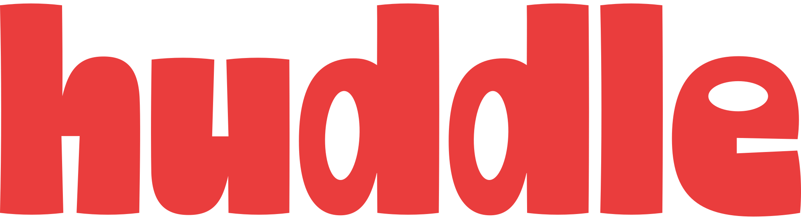

<p align="center">
  
</p>

# Huddle Server: Your Meetings, Processed on Your Own Machine


**Huddle Server** is the self-hosted companion to [Huddle](https://github.com/scoopy115/huddle).
It runs the same engine on a machine of your own: a home server, a NAS, a VPS. The Huddle app
sends a recording over, the server transcribes it, separates the speakers and writes the notes,
and the result lands back in the app. Your laptop stays cool, and nothing ever leaves hardware
you control.

There is no hosted version. You run it, for yourself or for a few people you trust.

---

## 🚀 What it does

### 📡 Processing for your Huddle apps
* **Offload the heavy work:** transcription (Whisper), speaker separation (pyannote + TitaNet)
  and notes (a local model through Ollama) run on the server instead of the laptop that recorded.
* **Per device:** every Mac connects with its own client key. Revoke one and it is out, together
  with the MCP tokens it made.
* **Results come back:** transcript, speakers with their voice embeddings and the notes are
  imported into the app; recognising known voices still happens on the Mac.

### 🖥️ A dashboard that is also a Huddle
* **Record in the browser:** the microphone of any device (phone, Windows, Linux) and, in Chrome
  and Edge, the audio of a tab or screen for online calls.
* **Everything from the app:** meetings with the player and transcript, speakers you rename and
  let the server remember, projects, action items, search, Ask, Refine, ⌘K.
* **Import** an audio file and get the same treatment.

### 👥 Accounts, scopes and privacy
* **Admin and users:** the first account is the admin. Invite people with a link, or open
  registration and approve accounts yourself.
* **Who sees what:** a client sees its own recordings; an admin can let a client see everything
  on the server. Projects and known voices are per account, so one person's voices never name
  speakers in another person's recordings.
* **AI per client:** switch notes off for a client and it gets transcripts only.
* **Two-factor authentication** with any authenticator app.

### 🤖 MCP for your AI tools
* **One endpoint, scoped tokens:** `/mcp` serves Claude Code, Claude Desktop, Cursor and other MCP
  clients. A token is made per client and sees exactly what that client sees.

### 🔒 Private by design
* No telemetry, no analytics, no external services. The only outbound traffic is the model
  downloads you start and, if you choose a domain, Let's Encrypt.
* Audio retention and a storage cap keep disk use in hand; transcripts and notes are kept.
* Keys and tokens are stored hashed and shown once. Sessions are HttpOnly cookies; every change
  needs a CSRF header; login is throttled; the API documentation endpoints are off.

---

## 📦 Install

Requirements: Linux or macOS with Docker and Docker Compose, 8 GB of RAM (16 GB with an AI
model), and a few GB of disk for the models you choose.

```bash
curl -fsSL https://raw.githubusercontent.com/scoopy115/huddle-server/main/install.sh | sh
```

The installer asks for a name and a port, writes `~/huddle-server/.env` and starts two
containers: the server and Ollama. Then:

1. Open **http://\<host\>:48731**, create the admin account and follow the setup: a transcription
   model, the speaker models and, optionally, an AI model for the notes.
2. **Clients → New client key.** In Huddle on your Mac: Settings → Server → the address and the
   key → Connect. From then on Huddle asks after each recording whether to process it here or
   on the server.

Prefer to do it by hand? Copy [`docker-compose.yml`](docker-compose.yml) and
[`.env.example`](.env.example) (as `.env`) into a folder and run `docker compose up -d`.

### TLS

The server speaks plain HTTP on one port. Put the reverse proxy you already run in front of it,
like any other self-hosted service. Without one, the built-in proxy does it: set
`COMPOSE_PROFILES=tls` and `HUDDLE_TLS_DIR=/certs` in `.env` (see `.env.example`). With
`HUDDLE_DOMAIN` it fetches a Let's Encrypt certificate; without, the server uses its own
certificate and the Huddle app shows its fingerprint once so you can confirm it against the
dashboard.

### Updating

```bash
cd ~/huddle-server && docker compose pull && docker compose up -d
```

---

## 🔌 Ports and endpoints

| Path | Who | Auth |
|---|---|---|
| `/` | the dashboard | session cookie, optional TOTP |
| `/v1/…` | Huddle apps | client key `hsk_…` |
| `/mcp` | AI tools | MCP token `hmt_…` |

Everything on one port (`HUDDLE_PORT`, default 48731).

---

## 🧑‍💻 Development

Requirements: Python 3.11, Node 20+, the [Huddle](https://github.com/scoopy115/huddle)
repository checked out next to this one (the engine lives there).

```bash
scripts/fetch-engine.sh                      # ../Huddle/engine → vendor/engine (or clones it)
cd server && python3.11 -m venv .venv.nosync && .venv.nosync/bin/pip install -e ../vendor/engine -e ".[dev]"
.venv.nosync/bin/python -m pytest
cd ../dashboard && npm install && npm run build:server
HUDDLE_DATA_DIR=/tmp/hs ../server/.venv.nosync/bin/huddle-server serve     # http://localhost:48731
```

`npm run dev` in `dashboard/` serves the UI on :5180 and proxies the API to :48731.

Docker image: `scripts/fetch-engine.sh && docker build -t huddle-server:local .`, then
`HUDDLE_IMAGE=huddle-server:local docker compose up -d`. The GitHub workflow publishes
`ghcr.io/scoopy115/huddle-server` for amd64 and arm64 on every push to `main` and on `v*` tags.

`huddle-server --help` lists the CLI: accounts, client keys, model downloads, the certificate
fingerprint.

---

## ❤️ Credits & Acknowledgment

Huddle Server stands on the same open-source work as Huddle:

* **Transcription:** [Whisper](https://github.com/openai/whisper) via [CTranslate2](https://github.com/OpenNMT/CTranslate2)
* **Speaker separation:** [sherpa-onnx](https://github.com/k2-fsa/sherpa-onnx) with the [pyannote](https://github.com/pyannote/pyannote-audio) segmentation model and NVIDIA's TitaNet embeddings
* **Notes:** [Ollama](https://ollama.com) running local models such as Qwen
* **Server:** [FastAPI](https://fastapi.tiangolo.com), [React](https://react.dev), [Tailwind CSS](https://tailwindcss.com), [Caddy](https://caddyserver.com)

Huddle is created by Dylan Kiesebrink with extensive assistance from **Claude Fable 5.1**
(Anthropic) as a co-pilot for architecture, implementation and debugging.

---

## 📄 License

Huddle Server is released under the [MIT License](LICENSE).
